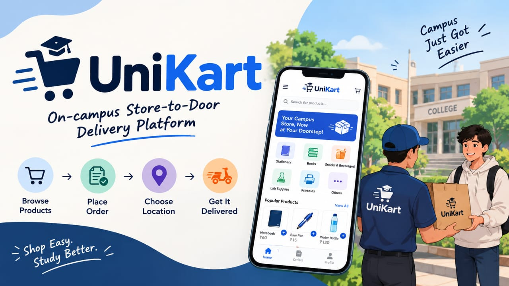

# 🛒 UniKart: On-Campus Store-to-Door Delivery Platform



UniKart is a campus-focused web application that lets students and teachers order products from stores inside the college campus and get them delivered to their classroom, department, hostel, or another permitted campus location.

**Live demo:** https://unikart-mits.onrender.com
*(Hosted on a free plan: the first load after a period of inactivity can take about a minute, and demo data may reset when the server restarts.)*

Built as a first-semester CSE micro project at MITS Gwalior.

---

## The problem

- Students and teachers have to leave their classroom, department, or hostel to buy basic items like notebooks, pens, files, and printouts.
- Visiting a store during lectures or busy schedules is inconvenient, and stores get crowded during breaks.
- There is no single place to browse campus stores and place an order.
- Shopkeepers handle requests manually, and customers cannot see the status of their order.

## The solution

UniKart brings campus stores into one platform. A customer picks a store, adds products to a cart, selects a predefined campus location such as *"CSE Department - Room 305"* or *"Hostel A - Room 214"*, and places the order. The store prepares it, a delivery person brings it, and the customer can follow the status until it arrives. Using predefined campus locations instead of postal addresses is what makes UniKart campus-specific.

**Order flow:**
`Login → Select Store → Browse Products → Add to Cart → Place Order → Store Accepts → Order Prepared → Delivery Picks Up → Delivered`

---

## Features

### Visitors (no login)
- Browse all approved campus stores and their products
- Search products and filter by category
- Asked to log in only when adding something to the cart

### Customers
- Registration and login
- Shopping cart with quantity management (one store per cart)
- Checkout with a predefined campus delivery location
- Order history with live status tracking (updates every 10 seconds)

### Storekeepers
- Dashboard with active orders and order history
- Accept or reject orders, and mark them as ready
- Add products and update price and stock
- Stock is returned automatically when an order is rejected

### Delivery personnel
- See orders that are ready for pickup
- Pick up an order (only one person can claim it) and mark it as delivered
- See the pickup store, delivery location, and the cash to collect

### Admin
- Overview statistics (users, stores, orders, delivered sales)
- Create storekeeper accounts (with their store) and delivery accounts
- Approve, suspend, or delete stores
- Monitor all orders
- Add and remove campus delivery locations

---

## Tech stack

| Part | Technology |
|---|---|
| Frontend | HTML, CSS, JavaScript, Bootstrap 5 |
| Backend | Node.js, Express.js |
| Database | SQLite (via `better-sqlite3`) |
| Authentication | `express-session` (cookie sessions), `bcryptjs` (password hashing) |
| Hosting | Render |

---

## Database design

| Table | Purpose |
|---|---|
| `users` | All accounts, with a role: customer, storekeeper, delivery, or admin |
| `stores` | Campus shops, their owner, and approval status |
| `products` | Items sold by each store, with price and stock |
| `locations` | Predefined campus delivery locations |
| `orders` | One row per order: customer, store, location, total, status, delivery person |
| `order_items` | Products inside each order, with the price at the time of purchase |

---

## Project structure

```
unikart/
├── server.js              # App entry point, middleware, routes, error handling
├── db.js                  # Database connection, tables, demo data
├── package.json
├── routes/
│   ├── auth.js            # Register, login, logout, current user
│   ├── stores.js          # Public store and product browsing
│   ├── orders.js          # Place orders, customer order history
│   ├── store.js           # Storekeeper dashboard API
│   ├── delivery.js        # Delivery API
│   └── admin.js           # Admin API
├── middleware/
│   └── auth.js            # requireLogin and requireRole checks
└── public/                # Frontend
    ├── index.html         # Home page
    ├── login.html
    ├── register.html
    ├── customer.html      # Shop
    ├── orders.html        # Customer orders
    ├── store.html         # Storekeeper dashboard
    ├── delivery.html      # Delivery page
    ├── admin.html         # Admin panel
    ├── css/style.css
    ├── js/                # Page scripts and shared helpers
    └── images/
```

---

## Run it locally

You need [Node.js](https://nodejs.org) 18 or newer.

```bash
git clone https://github.com/ceo-aryan/unikart.git
cd unikart
npm install
npm start
```

Open **http://localhost:3000**. For development with automatic restarts, use `npm run dev`.

The database file (`unikart.db`) is created automatically on the first run, together with demo stores, products, locations, and accounts.

### Demo accounts (local setup)

All accounts use the password `password123` unless `DEMO_PASSWORD` is set.

| Role | Email |
|---|---|
| Admin | `admin@unikart.com` |
| Customer | `student@unikart.com` |
| Storekeeper | `shop1@unikart.com`, `shop2@unikart.com` |
| Delivery | `delivery@unikart.com` |

### Optional environment variables

| Variable | Purpose |
|---|---|
| `SESSION_SECRET` | Secret used to sign login cookies (set a long random value when deploying) |
| `DEMO_PASSWORD` | Password for the seeded demo accounts |
| `PORT` | Port to listen on (default 3000) |

---

## Security and design decisions

- Passwords are stored only as **bcrypt hashes**.
- **Role-based access control** is enforced on the server for every protected API route, not just by hiding pages.
- **Prices and totals are calculated on the server.** The browser sends only product ids and quantities, so prices cannot be tampered with.
- Orders are saved inside a **database transaction**, so the order, its items, and the stock reduction succeed or fail together.
- Order status changes follow fixed rules (for example, a storekeeper cannot mark a delivered order as ready), and ownership is checked so one store cannot touch another store's orders.
- Two delivery people cannot claim the same order.
- All database queries use **parameterized statements** (protection against SQL injection), and user text is escaped before being shown (protection against XSS).
- Login attempts are rate-limited, and session cookies are `HttpOnly`.

---

## Limitations

- Payment is cash on delivery only.
- No real-time GPS tracking; order status refreshes by polling every 10 seconds.
- Deliveries are limited to the predefined campus locations.
- On the free hosting plan, data can reset when the server sleeps or restarts.

## Future scope

- UPI and online payment integration
- Real-time delivery tracking and push notifications
- Estimated delivery time and digital invoices
- Ratings and reviews
- QR-based order verification
- Low-stock alerts and inventory prediction
- Integration with college ID / IUMS
- Support for multiple campuses

---

## Author

**ARYAN SINGH**, 1st year, Computer Science and Engineering, MITS Gwalior
